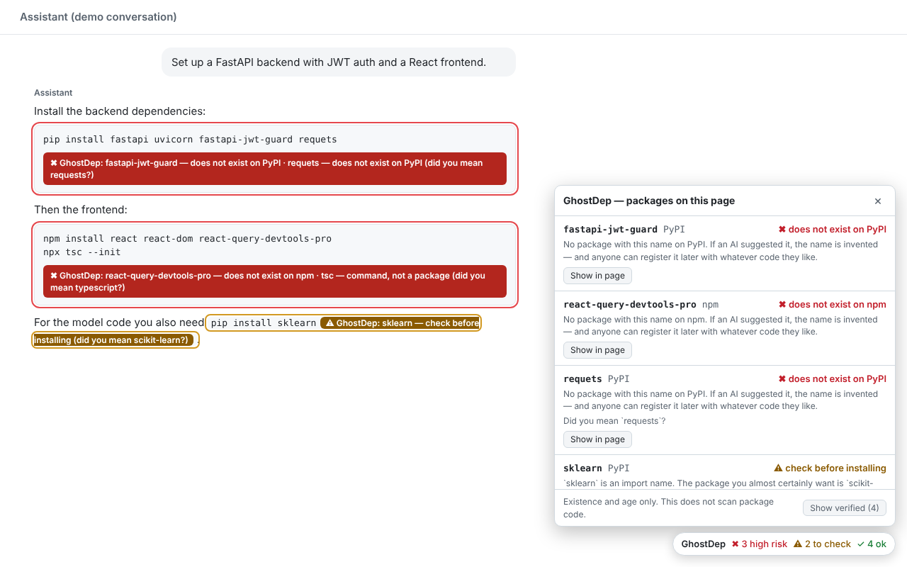

# GhostDep

> Chrome extension. Catches packages your AI made up: it checks every `pip`, `npm` and `cargo` install command in an AI chat answer against the real registry and flags names that do not exist, are brand new, or imitate a popular package.

**Topics:** `chrome-extension` `manifest-v3` `slopsquatting` `supply-chain-security` `ai-safety` `pypi` `npm` `crates-io` `typosquatting` `javascript`



## Why

Language models invent plausible package names. Attackers register those names ("slopsquatting"), so the next person who pastes the suggested `pip install` gets their code. The existing defences are CLIs, MCP servers and CI checks, all of which run after you have left the chat. GhostDep puts the check on the page where the suggestion appears.

## What it flags

| Flag | Trigger |
|---|---|
| `✖ does not exist on PyPI / npm / crates.io` | Registry returns 404 |
| `✖ high risk` | First published under 30 days ago, or one edit away from a well-known package and young or barely used |
| `⚠ check before installing` | Under 180 days old, very few downloads, a Python import name used as a package name (`sklearn`, `cv2`, `yaml`), a near-miss of a well-known name, or marked deprecated on npm (the registry's message is quoted) |
| `⚠ command, not a package` | `npx tsc`, `npx ng`, `npx firebase` and 33 similar: the command ships in a differently named package (`typescript`, `@angular/cli`, `firebase-tools`). Dropped when the page also installs that package |
| `⚠ not on npm (workspace package?)` | A `package.json` dependency that is missing from npm but shares the `@scope` of the package that depends on it. Almost always a local workspace sibling |
| `? could not check` | Lookup failed. Never shown as a pass |

Understood commands: `pip` / `pip3` / `python -m pip`, `uv add`, `uv pip install`, `uvx`, `pipx`, `poetry add`, `pdm add`, `pipenv install`, `npm install|i|add|exec|create|init`, `pnpm add|dlx|create`, `yarn add|dlx|create`, `bun add|x|create`, `npx`, `bunx`, `cargo add|install`. Also `package.json` dependency blocks, `requirements.txt` blocks, Dockerfile `RUN` lines and CI `run:` steps.

## Install (unpacked)

1. Open `chrome://extensions` and turn on **Developer mode**.
2. Click **Load unpacked** and pick the `extension` folder of this repo.
3. Ask any supported chat for a project with dependencies. Flags appear under the code blocks, with a summary at the bottom right.

Runs by itself on ChatGPT, Claude, Gemini, AI Studio, Copilot, Perplexity, DeepSeek, Grok, Mistral and Poe. Anywhere else (a blog post, Stack Overflow, a README): click the toolbar icon, then **Scan this page**.

That includes a `package.json` or `requirements.txt` opened on GitHub, in either the normal file view or the raw view, and a local file opened as `file://` once **Allow access to file URLs** is switched on for the extension.

## Repo layout

| Path | What it is |
|---|---|
| `extension/` | The extension itself. This folder is what Chrome loads and what gets zipped for the store |
| `extension/lib/core.js` | Pure logic: parse install commands, name similarity, decide the verdict |
| `extension/lib/popular.js` | Well-known package names, Python import-name aliases, npx command-to-package map |
| `extension/background.js` | Service worker: registry lookups for PyPI, npm and crates.io, with caching |
| `extension/content.js` | Reads code blocks once they stop streaming, outlines them, draws the panel |
| `test/` | Unit tests (Node's built-in runner, no dependencies) |
| `e2e/` | Playwright harness: loads the extension in Chromium against a fixture chat page |
| `store/` | Chrome Web Store assets and `LISTING.md` with every field's text |
| `scripts/package.sh` | Builds `dist/ghostdep-<version>.zip` for upload |

## How it works

```
content.js                                 background.js (service worker)
  read <pre>/<code> text once it has   ──►   well-known name?  answer locally, no request
  stopped changing for 1.5 s                  else GET pypi.org/pypi/<name>/json
  extract (registry, name) pairs                   GET registry.npmjs.org/<name>/latest (+ downloads, + created)
  outline block + panel                ◄──         GET crates.io/api/v1/crates/<name>
```

- **Streaming-safe.** A block is only parsed after its text has been stable for 1.5 seconds, so half-typed names are never looked up.
- **Your own typing is ignored.** Text inside editable `textarea` and `contenteditable` elements is skipped. Read-only text areas are read, because that is where GitHub's file view keeps the file.
- **No DOM insertion in the chat app.** Flags are CSS `::after` content plus an outline; the panel lives in a shadow root outside `<body>`.

## Develop

```bash
npm test                 # unit tests: logic + Chrome Web Store manifest limits
npm install              # only needed for the next two (installs Playwright)
npx playwright install chromium
npm run e2e              # loads the extension in Chromium, live registry lookups
npm run screenshots      # regenerates the 1280x800 store screenshots
npm run package          # builds dist/ghostdep-<version>.zip
```

`npm run e2e` makes live requests to the package registries, so a network blip shows up as one failed check. Rerun before reading anything into it.

To release: raise `version` in `extension/manifest.json` and `package.json`, run `npm run package`, upload the zip in the Chrome Web Store developer dashboard.

## Privacy

See [PRIVACY.md](PRIVACY.md). The only data that leaves the browser is a package name, sent to the public registry it would be installed from, and only for names not on the built-in well-known list. No chat text, no analytics, no server of mine.

## Limits

- A lookup that fails stays "could not check" until the page is reloaded; it is not retried.
- Existence, age, popularity and npm deprecation only. It does not download or scan package code. An old, popular, compromised package passes.
- PyPI's JSON API has no download counts, so PyPI verdicts rest on existence, age and name similarity.
- The well-known lists in `extension/lib/popular.js` are hand-maintained (about 890 names, each verified to exist). A legitimate package one edit away from a listed one gets a `⚠` unless it is heavily downloaded.
- Thresholds (30 / 180 days, 500 weekly downloads) are judgement calls in `extension/lib/core.js`, not research-derived constants.
- Go, RubyGems, Maven, conda and `import` statements are not covered.

## Skills demonstrated

Manifest V3 (service worker, content scripts, `activeTab` + `scripting` on-demand injection) · shell command and manifest parsing · typosquat detection (Damerau-Levenshtein, normalisation, alias maps) · registry APIs for PyPI, npm and crates.io · streaming-aware DOM observation · privacy-preserving lookups · Playwright extension testing

## License

MIT. See [LICENSE](LICENSE).
